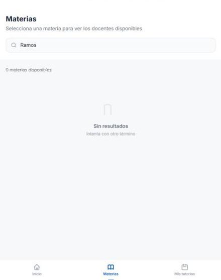
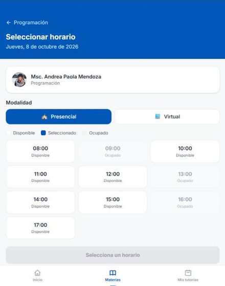
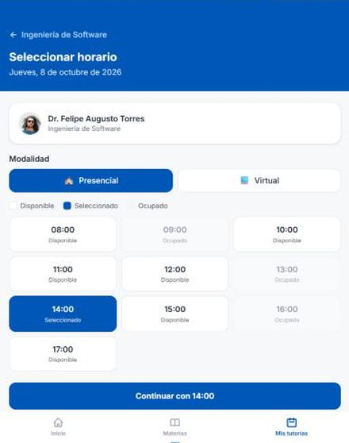

# Actividad A2 · Caza heurística en Tutoría Fácil

| Dato | Valor |
| --- | --- |
| Parte de la exposición | Parte 1 · Tema general |
| Láminas | 23 (aviso, 30 s de preparación) y 24 (actividad) de [G5_Exposicion_APE6.html](../../Presentacion/G5_Exposicion_APE6.html) |
| Minuto planificado | 30 |
| Duración | 3 minutos (2 min en grupo + 1 min para compartir, 15 s por grupo) |
| Participan | G1, G2, G3 y G4 a la vez, cada grupo con su propio caso |
| Tema del G5 que practica | Evaluación heurística de Nielsen aplicada al prototipo |
| Caso de estudio | Tutoría Fácil UTA (prototipo en Figma Make) |

## Consigna

En su captura encuentren **un problema**, la **heurística** que viola (1–10) y una **severidad** (0–4).

## Grupo 1

*Inicio: buscar «Ramos»*

**Caso:** El buscador de Inicio dice «materia o docente».

**Respuesta esperada:** **H1**: no encuentra docentes y el estado vacío no sugiere nada · #4, #9 · severidad 3.

## Grupo 2

*Seleccionar horario*

**Caso:** Pantalla para elegir hora con la Msc. Mendoza.

**Respuesta esperada:** **H4**: no hay selector de fecha (#3, #7, sev. 3) · o **H6**: «Ocupado» no responde y es gris muy claro (#1, sev. 2).

## Grupo 3

*Detalle de tutoría pendiente*

**Caso:** Detalle de la tutoría de Base de Datos.

**Respuesta esperada:** **H3**: solo «Cerrar», no se puede cancelar (#3, #4, sev. 3) · o **H10**: «Pendiente» sin explicación (#10, sev. 1).

## Grupo 4

*Reprogramar (era 09:00 virtual)*

**Caso:** Llegaron aquí con «Reprogramar» desde una tutoría virtual de las 09:00.

**Respuesta esperada:** **H8**: preselecciona 14:00 y Presencial, y «atrás» dice «Ingeniería de Software» · #4, #6 · severidad 2.

## Cómo se evalúa

- +1 punto en el marcador del HTML de preguntas para cada grupo cuya respuesta coincida con la esperada.
- El G5 muestra las respuestas en la lámina con el botón «Mostrar respuestas».
